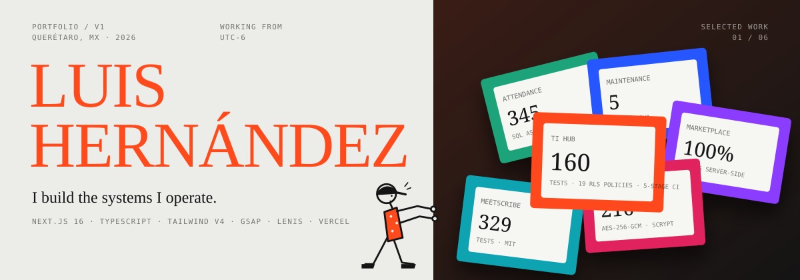
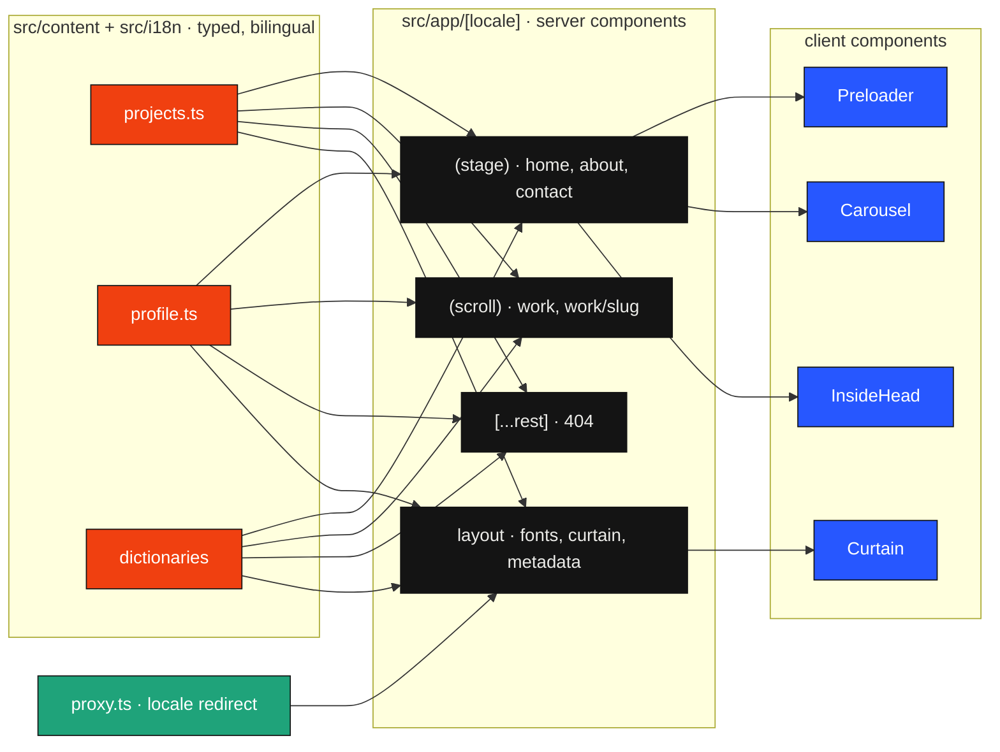

<p align="center">
  
</p>

<p align="center">
  <a href="https://github.com/LittlePitza/portfolio/actions/workflows/ci.yml"></a>
  
  
  
  
  <a href="LICENSE"></a>
</p>

<h3 align="center"><a href="https://lhernandez.dev">lhernandez.dev</a></h3>
<p align="center">Full-stack developer and IT lead in Querétaro, Mexico.<br>Selected projects, technical capabilities and professional experience.</p>

<br>

## The idea

Most portfolio sites show screenshots and let you guess. This one treats every
project like a technical sheet: role, stack, launch date and the figures that
can be checked, with context about the problem, implementation and outcome.

The presentation borrows from the best creative portfolios: a character that
pushes a black curtain off the screen, a name set in a giant serif, a
full-screen carousel you move with the wheel, a swipe or the arrow keys, and a
frame with a local clock. Underneath it is a static, typed, bilingual Next.js
app with pre-rendered pages and no runtime data layer at all.

<br>

## What is inside

<table>
  <tr>
    <td width="33%" valign="top">
      <strong>Opening</strong><br>
      An illustrated character walks in, strains, and shoves the curtain to the right. Plays once per tab, on Home only, and is skipped under <code>prefers-reduced-motion</code>.
    </td>
    <td width="33%" valign="top">
      <strong>Selected work</strong><br>
      Home opens with the name and then turns into a carousel of nine projects. The wheel, a vertical swipe or the arrow keys move one project per gesture (GSAP Observer); each cover rolls in from below and the neighbours peek in at the edges. <code>/work</code> is the index: every project in one table, with its cover following the cursor.
    </td>
    <td width="33%" valign="top">
      <strong>Small details</strong><br>
      Between pages a light curtain rises with the destination's name while the character walks in pushing a line. About is a single screen: tap the portrait and the top of his head lifts while the things on his mind float out, each with its own story. The 404 is an incident report. Leave the tab and the title asks you back.
    </td>
  </tr>
  <tr>
    <td width="33%" valign="top">
      <strong>Two languages</strong><br>
      <code>/en</code> and <code>/es</code>, chosen at the edge from a cookie or the browser. Every content string is typed as <code>Localized&lt;T&gt;</code>; a missing translation fails the build. UI strings live in the dictionaries.
    </td>
    <td width="33%" valign="top">
      <strong>Two page modes</strong><br>
      Route groups <code>(stage)</code> (Home, About, Contact) and <code>(scroll)</code> (index and case studies). On a large screen a stage page fits exactly one viewport; on a phone or a short window it stacks and scrolls under a compact bar.
    </td>
    <td width="33%" valign="top">
      <strong>Generated images</strong><br>
      Favicon, Apple icon and per-language OpenGraph cards are built from the same mark with <code>next/og</code>, using the bundled Instrument Serif and Geist Mono.
    </td>
  </tr>
</table>

<br>

## Stack

| Layer | Choice | Why |
| --- | --- | --- |
| Framework | Next.js 16, App Router, React 19 | Static generation for every route, server components by default |
| Language | TypeScript, strict | The content model is typed; the compiler proofreads both languages |
| Styling | Tailwind v4 with `@theme static` tokens | Colours, type scale, spacing, easing and durations are declared once in `globals.css` |
| Motion | CSS for entrances and hovers, GSAP 3.15 (`useGSAP`, Observer) for the choreographies | Native scroll everywhere; tokens mirrored in `src/lib/motion.ts` |
| Type | Instrument Serif, Geist, Geist Mono | Serif for scale, sans for reading, mono for labels and numbers |
| Hosting | Vercel | Preview per branch, zero config for the App Router |

<br>

## Architecture



Server components resolve content for one locale and pass plain strings down.
Client components own motion and nothing else. The full walkthrough, including
the request path and the reasons behind each omission, is in
[docs/architecture.md](docs/architecture.md).

```
src/
├── app/[locale]/        (stage): home, about, contact · (scroll): work, work/[slug] · [...rest] and not-found: the 404
├── components/
│   ├── chrome/          StageShell, ScrollShell, ChromeTop, ChromeBottom, CompactBar, MenuLayer, Curtain, StageHint, NotFoundScreen, TabTitle, Clock, LocaleSwitch, UpdateWatcher
│   ├── preloader/       Preloader, Character, PreloaderContext
│   ├── home/            Portada, Canvas, Carousel, useCarousel, placeCovers, ProjectItem, NamesList
│   ├── work/            IndexTable, IndexPreview, CaseHeader, CaseNumbers, CaseNav, Cover, covers/ (one drawing per project)
│   ├── about/           InsideHead, AboutColumns, CapabilitiesLayer, JourneyLayer, ProcessLayer
│   ├── contact/         ContactEmail, ContactCards, ParallaxStack
│   └── ui/              PageTitle, MetaList, Figure, Layer, EnterOnView, enterStep, useAnchorLayer, Mark, Icons
├── content/             site.ts, projects.ts, profile.ts, head.ts
├── assets/fonts/        TTFs used only for generated images
├── i18n/                config, dictionaries/en, dictionaries/es
├── lib/gsap.ts          registers useGSAP
├── lib/motion.ts        easing, durations and media queries, mirroring the tokens in globals.css
└── proxy.ts             edge redirect to /en or /es
```

<br>

## Running it

Requires Node 24 (see `.nvmrc`).

```bash
npm install
npm run dev
```

| Script | What it does |
| --- | --- |
| `npm run dev` | Development server with Turbopack |
| `npm run check` | ESLint, a typecheck that regenerates route types first, and the cover-placement check |
| `npm run build` | Production build with pre-rendered localized pages |
| `npm start` | Serve the production build |

<br>

## Editing content

- **A project** is one object in `src/content/projects.ts`. Add it to the
  array and it appears in the home carousel and in the `/work` index,
  gets its own route under `/work/`,
  and lands in the sitemap. Its cover is drawn, not photographed: a component
  in `src/components/work/covers/`, registered by slug in `covers/index.ts`,
  recreates two or three pieces of the app in HTML and CSS with demo data.
  Give it a caption line (`coverCaption`) and a description (`coverAlt`) in
  both languages. Without a drawing, the cover shows the project's name on
  its colour.
- **Facts, capabilities, process and experience** live in
  `src/content/profile.ts`.
- **UI strings** live in `src/i18n/dictionaries/`. The Spanish file is typed
  against the English one.
- **Identity** (name, email, links, résumé paths) lives in
  `src/content/site.ts`.

### Résumés

The Spanish and English PDFs in `public/cv/` are generated from
`scripts/cv/cv.json`. After editing the content, rebuild both versions:

```bash
python -m pip install -r scripts/cv/requirements.txt
python scripts/cv/build_cv.py
```

The generator uses Georgia fonts from Windows. On other systems, supply
`--fonts /path/to/fonts` with the four Georgia TTF files. It checks the two-page
limit; visually review both PDFs after each content change.

<br>

## Design notes

The palette is deliberately small: a warm grey page, near-black ink and one
accent, orange, kept for the name and the details. Type and spacing come from
tokens in `src/app/globals.css`; entrances are one CSS primitive (`data-enter`
with a stagger index), and GSAP only runs the opening, the page curtain, the
carousel and the head. Project colours only ever appear inside covers.

Covers are drawings rather than screenshots. Each one lays two or three pieces
of the app on a mat of the project's colour, recreated from the app's own tokens, typefaces and copy, with
demo data instead of anything that would need hiding. The pieces are chosen to
say what the project is about, not to show a whole screen: the append-only
trigger refusing a delete, a ticket running out of SLA, a volume tier being
repriced. Everything inside is sized from the cover's own box through a
container query, so a cover is equally sharp on a phone and across a case
page, and costs no image requests.

The reference for the experience is [huyml.co](https://huyml.co). The
analysis of what makes it work, and what this site does differently, is kept in
[docs/00-analisis-referencia-huyml.md](docs/00-analisis-referencia-huyml.md).

<br>

## Roadmap

- Final illustration for the character
- Real, anonymised screenshots of the internal systems
- Experiments and open-source toys in the index

<br>

<p align="center">
  <sub>Code under MIT. Content, résumés and illustrations are personal material. Built by <a href="https://github.com/LittlePitza">Luis Hernández</a>.</sub>
</p>
