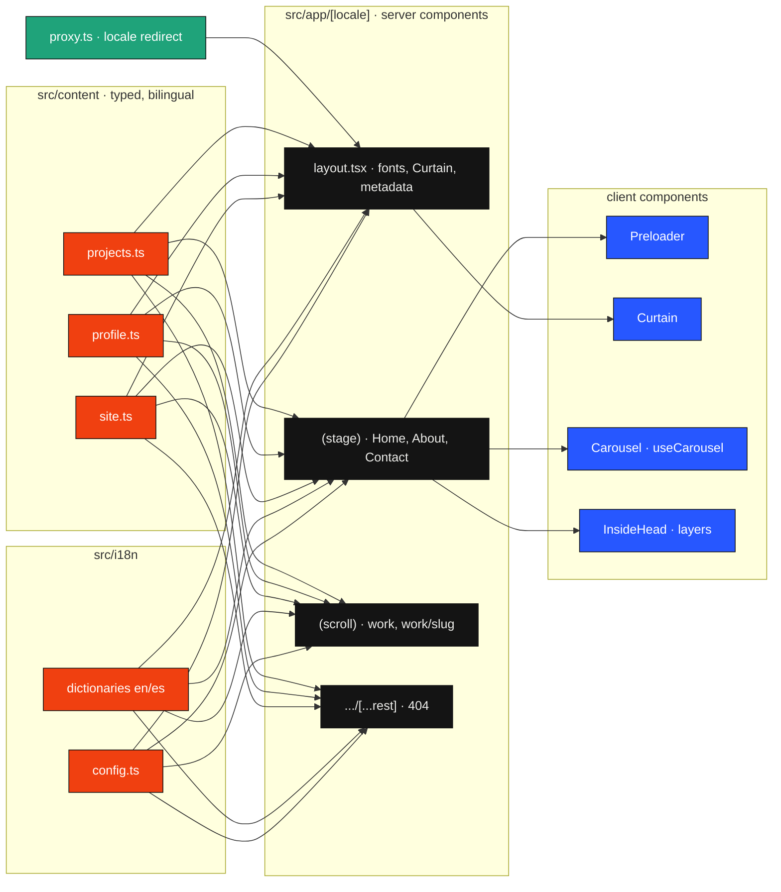

# Architecture

How the site is put together, and why. The short version: static content, typed
end to end, rendered ahead of time, with motion layered on top and never in the
way of the content. The design that was built is in
[02-diseno-v2.md](02-diseno-v2.md); this document describes the code as it
ended up.

## Layers

## Request path

1. `src/proxy.ts` runs at the edge. A request without a locale prefix is
   redirected to `/en` or `/es`, chosen from the `locale` cookie or the
   `Accept-Language` header. Static files and internals are skipped.
2. `src/app/[locale]/layout.tsx` is the root layout. It validates the locale,
   loads the three fonts, builds per-language metadata, puts the `<head>`
   script (it decides whether the preloader runs and sets `html[data-js]`) and
   wraps everything in `Curtain`, `TabTitle` and `UpdateWatcher`.
3. Every page is a server component. It resolves the content for its locale
   and hands plain strings to client components, so nothing bilingual ships to
   the browser twice.
4. `generateStaticParams` on the layout and on `work/[slug]` produce localized
   routes at build time. There is no runtime data source.
5. `next.config.ts` redirects `/:locale/playground` to `/:locale/work`
   (permanent) and inlines the build's commit and date.

## Two page modes

Routes are split into two groups, each with its own layout:

- **`(stage)`**: Home, About and Contact (and the 404 screen). `StageShell`
  puts the frame in two rows, above and below the page. With the `stage:`
  variant active (`min-width: 64rem` and `min-height: 40rem`, defined once in
  `globals.css` and repeated as `MQ.stage` in `src/lib/motion.ts`), a page
  marked `data-fit` is composed to fit exactly one viewport (`100svh`, no
  document scroll). Without `stage:` or without JavaScript the same page
  stacks and scrolls, under the compact bar.
- **`(scroll)`**: the `/work` index and the `/work/[slug]` case studies.
  `ScrollShell` always uses native scroll: the frame sits in the flow and
  leaves with the scroll, the 56 px compact bar comes back when scrolling up
  and the footer closes the page with the credits and the build stamp.

The 404 is drawn by `NotFoundScreen`. Two routes use it:
`[locale]/[...rest]/page.tsx`, which catches any path with no page inside the
language's layout (it answers 200 with `noindex`, in exchange for keeping the
fonts, language and scripts), and `[locale]/not-found.tsx`, for a `notFound()`
thrown inside a language, such as an unknown project. `IncidentReport` shows
the status, the route that was asked for and the cause.

## The chrome

It lives in `src/components/chrome/`. On large screens, `ChromeTop` (mark,
navigation, city and clock, copyable email) and `ChromeBottom` (hint, résumé,
language) are the two rows; on small screens `CompactBar` is the whole frame
and hides on the way down (`useHideOnScroll`). `MenuLayer` is a full-screen
modal `<dialog>` with the four links (`NavLinks`), the clock, the email, the
résumé and the language. `StageHint` takes the bottom-left slot: how to move
through Home, the year elsewhere. `BuildStamp` shows the build's commit and
date.

## Content model

Content lives in TypeScript, not in a CMS, because it changes a few times a
year and benefits from type-checking more than from an editor UI.

- `Localized<T>` is `Record<"en" | "es", T>`. Every user-facing string in the
  content files is one of these, so a missing translation is a compile error.
- `Project` carries what the list and the case page need: role, stack, launch,
  status, `numbers` (the verifiable figures) and `body`, the case-study
  paragraphs.
- The cover is a drawing, not an image: a component in
  `src/components/work/covers/`, registered by slug in `covers/index.ts`, that
  recreates two or three pieces of the app in HTML and CSS with demo data,
  sized from its own box through a container query. `Cover.tsx` renders it on
  the server on the project's colour.
- The dictionaries in `src/i18n` hold UI strings only, including those that
  used to be chosen with `locale === "es" ? … : …`. `es.ts` is typed as
  `typeof en`, which keeps both files in the same shape.

## Tokens and motion

Tokens live once in `src/app/globals.css`, inside `@theme static`: colours
(`bg`, `paper`, `ink`, `muted`, `line`, `accent`), the type scale (`ui`,
`body`, `lead`, `heading`, `title`, `display`, `figure`), margins, layers
(`z-*`), the `--ease` curve, the durations (`--dur-fast`, `--dur-base`,
`--dur-slow`), the stagger and the blurs. `src/lib/motion.ts` repeats the
motion ones GSAP needs (`EASE`, `DUR`, `REDUCED_FADE`; the stagger is only
read by CSS) and holds the media queries (`MQ.motion`, `MQ.fine`,
`MQ.stage`); the two files change together.

The split between engines is simple:

- **CSS** does whatever is going from one state to another: the entrance
  primitive (`[data-enter]` with an inline `--i`, which `enterStep` writes and
  `EnterOnView` activates below the fold), hovers, the neighbours' blur
  (`data-siblings`) and the carousel's states.
- **GSAP** does the choreographies with state, always through `useGSAP` with a
  scope. `src/lib/gsap.ts` registers only `useGSAP`; the one extra plugin is
  `Observer`, which `useCarousel` registers. There is no ScrollTrigger, no
  smooth scroll and no custom cursor.

With `prefers-reduced-motion` there is no preloader and no curtain, the
primitive shrinks to a 150 ms fade and the carousel changes with that same
fade.

## The choreographies

- **Preloader** (`components/preloader/`): once per tab and only on Home. The
  character walks in, strains and pushes the black curtain to the right. The
  `<head>` script decides whether it runs (`data-intro`); a safety closes it
  after six seconds and there is a button to skip it.
- **Page curtain** (`chrome/Curtain.tsx`): an internal navigation raises a
  light panel with the destination's title and route while a character walks,
  pushing a line; once the route is ready the line reaches the end and the
  panel leaves through the top. It is skipped for back/forward, links to the
  same page, modifier keys, a language switch and reduced motion. If the route
  never arrives, it lifts after six seconds.
- **Home carousel** (`components/home/`): `Canvas` is the DOM both layouts
  share (stacked or on the stage). `useCarousel` keeps the position (0 is the
  cover screen, 1 to n the projects) and takes input through GSAP's `Observer`
  plugin: the wheel, a vertical swipe or a drag give one step per gesture,
  with a short pause so inertia does not skip several projects; the arrows,
  Page Up/Page Down, Home and End also work, and the names in the list jump to
  their project. One continuous value travels from the old position to the new
  one, and `placeCovers.ts`, a pure function, places each cover by
  interpolating between five slots; the neighbours show 26 % of their height.
  The position is remembered for the tab, an `aria-live` region announces each
  project and the inactive ones are `inert`. `scripts/check-place-covers.mjs`
  (part of `npm run check`) verifies that at every whole position the active
  cover sits in slot 0.
- **About** (`components/about/`): a single screen. `InsideHead` opens the
  portrait's head (click, tap or Enter; Escape or a second click closes it)
  and the objects from `src/content/head.ts` float out, each with its card;
  while it is open, the rest of the page blurs. Below go the four lists
  (`AboutColumns`) and three layers (`CapabilitiesLayer`, `JourneyLayer`,
  `ProcessLayer`) which are modal `<dialog>`s anchored to the URL by
  `useAnchorLayer` (`#capacidades`, `#trayectoria`, `#proceso`). Without
  JavaScript they read as ordinary sections.
- **Contact**: the address (`ContactEmail`) copies itself when pressed, and
  four cards (`ContactCards`) follow the pointer with a parallax of about 6 px
  (`ParallaxStack`).
- **Index** (`/work`, which replaces `/playground`): `IndexTable` lists the
  projects and, with a fine pointer and no reduced motion, `IndexPreview`
  shows the cover of the row under the cursor.

## Details that make it feel alive

- `TabTitle` alternates two lines in the document title while the tab is
  hidden and restores the original on return.
- `src/lib/navigation.ts` knows whether the visitor has moved inside the site,
  so the opening does not replay after a client-side navigation.
- Each figure's text rolls character by character when a project becomes
  active, and the build stamp shows which commit is serving the page.

## Always on the latest version

Pages are served with `max-age=0, must-revalidate` and Vercel keeps a separate
cache per deployment, so a fresh load is always current. What went stale was
an already open tab: Vercel's skew protection keeps serving a tab from the
deployment it was loaded from, for up to twelve hours.

- `next.config.ts` inlines the deployment id into the build, and
  `/api/version` answers, uncached, which deployment is live. That request
  carries no deployment header, so skew protection does not pin it.
- `src/lib/version.ts` compares the two, at most once every fifteen seconds.
- `UpdateWatcher` reloads when the visitor returns to the tab, focuses the
  window or restores the page from the back/forward cache and a newer
  deployment is live; if they stay on the page it offers a one-tap refresh.
- `Curtain` asks before navigating and, if the site has moved on, loads the
  destination as a full page. The language switch does the same.

## Identity assets

`src/app/icon.svg` is the monogram: L and H built from bars on an accent
field. `apple-icon.tsx` and `[locale]/opengraph-image.tsx` redraw the same
geometry with `next/og`, so every icon and social card comes from one source.
The two TTFs under `src/assets/fonts` exist only for those generated images;
the site itself loads fonts through `next/font` (Instrument Serif, Geist and
Geist Mono).

## Quality gates

`npm run check` runs ESLint, a typecheck that regenerates Next's route types
first, and `check:covers` (the `placeCovers` check). CI runs lint, typecheck
and a production build on every push and pull request.

## Deliberate omissions

- No database or Supabase. Nothing here needs a runtime store.
- No i18n library. Two locales and a handful of routes do not justify one.
- No MDX. Case-study bodies are arrays of paragraphs.
- No smooth scroll, Rive, ScrollTrigger, custom cursor or brutalist kit: the
  v2 uses native scroll, a character drawn in SVG and restrained tokens.
